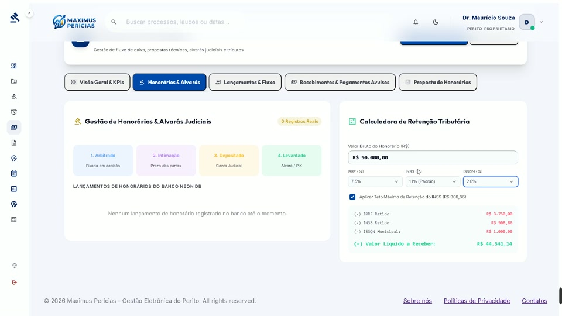

# Renderizar Assets Visuais (Feed, Reels e Stories)

Processo de compilação de templates HTML/CSS responsivos e renderização via Playwright (`skills/image-creator/SKILL.md`) para gerar os slides do Carrossel de Feed (`1080x1440`), Capa e Storyboards de Reels (`1080x1920`) e Sequência de Stories (`1080x1920`), mantendo 100% de fidelidade visual com `https://pericias.btech.inf.br`.

## Process

1. **Inspeção dos Textos Aprovados e Mapeamento de Frames Reais:**
   - Ler integralmente os arquivos aprovados: `feed-carousel.md`, `reels-script.md` e `stories-sequence.md`.
   - Verificar cada referência de frame real indicada pelos redatores no diretório `squads/maximus-pericias-instagram/references/video-frames/` (ou `references/landing-page/hero-light.png`) para garantir que o caminho relativo a partir do arquivo HTML esteja exato e que a imagem exista no disco.
   - Validar que nenhum slide de Feed ultrapassa 25 palavras de texto visível e que os códigos hexadecimais estão restritos a `#0047AB`, `#002366`, `#0B1329`, `#FFD700`, `#C5A021`, `#F9F9FF`, `#FFFFFF` e `#111318`.

2. **Compilação dos Slides HTML do Carrossel de Feed (`1080x1440` - 4:5):**
   - Utilizar a estrutura base de `squads/maximus-pericias-instagram/pipeline/data/template-reference.html`.
   - Para cada slide do carrossel (7 a 10 slides), criar um arquivo HTML dedicado em `squads/maximus-pericias-instagram/output/assets/html/feed-slide-XX.html` aplicando a variação aprovada correspondente:
     - **Template A (Dark Royal Prestige - `#0B1329` -> `#002366` + `#FFD700`):** Aplicado na Capa (Slide 1), no Slide de Solução/MAX AI e no Slide de Fechamento/CTA.
     - **Template B (Clean Editorial Light - `#F9F9FF` + `#0047AB` + `#C5A021`):** Aplicado nos slides analíticos, comparativos de tempo/esforço e detalhamento de retenções tributárias (IRRF, INSS, ISSQN).
     - **Template C (B2B Command Bento Grid - `#001946` + `#0052CC` + `#FFD700`):** Aplicado nos slides de arquitetura multi-tenant, RBAC, Prazos CPC e Recebimento de Demandas B2B.
   - Injetar o print real do software dentro da moldura `.browser-window` com sombra profunda e nitidez de 100%.

3. **Compilação de Capa de Reels e Sequência de Stories (`1080x1920` - 9:16):**
   - Criar o arquivo HTML da capa do Reels (`reels-cover.html`) e os key-frames visuais de apoio em `1080x1920`, garantindo que o título principal e a métrica heroica estejam perfeitamente centralizados dentro da zona segura central `1080x1440` (visível também na grade 4:5 do perfil).
   - Criar os arquivos HTML dos 5 a 7 cards da sequência de Stories (`story-01.html` a `story-XX.html`) em `1080x1920`, respeitando `250px` livres no topo e `340px` livres na base, além de demarcar a área visual limpa para o sticker nativo de Enquete, Caixa de Perguntas ou Link.

4. **Renderização Automatizada via Playwright (`image-creator`) e Auditoria Visual:**
   - Executar o script de captura via Playwright em `1080x1440` para todos os slides do Feed (`feed-slide-01.png` a `feed-slide-XX.png`) e em `1080x1920` para a capa do Reels (`reels-cover.png`) e cards de Stories (`story-01.png` a `story-XX.png`), salvando em `squads/maximus-pericias-instagram/output/assets/`.
   - Inspecionar cada arquivo `.png` gerado quanto a carregamento de fontes (`Hanken Grotesk` e `Inter`), ausência de overflow, legibilidade em tela mobile e contraste WCAG AAA.
   - Registrar o inventário completo no manifesto `squads/maximus-pericias-instagram/output/visual-assets-manifest.md`.

## Output Format

```markdown
# Manifesto de Assets Visuais Renderizados - @maximus.pericias

## 1. Carrossel de Feed (1080x1440 - Proporção 4:5)
| Slide | Template Aplicado | Frame do Software Integrado | Arquivo HTML | Arquivo PNG Renderizado | Status Visual |
| :--- | :--- | :--- | :--- | :--- | :--- |
| Slide 01 | Template A (Dark Royal) | `vid1_frame_50.jpg` | `output/assets/html/feed-slide-01.html` | `output/assets/feed-slide-01.png` | Aprovado (Zero CLS) |

## 2. Capa e Key-Frames de Reels (1080x1920 - Proporção 9:16)
| Peça | Zona Segura 4:5 Verificada | Frame do Software Integrado | Arquivo HTML | Arquivo PNG Renderizado |
| :--- | :--- | :--- | :--- | :--- |
| Capa Reels | Sim (Y: 240px a 1680px) | `vid1_frame_95.jpg` | `output/assets/html/reels-cover.html` | `output/assets/reels-cover.png` |

## 3. Sequência de Stories (1080x1920 - Proporção 9:16)
| Card | Sticker Planejado | Margem Superior/Inferior | Arquivo HTML | Arquivo PNG Renderizado |
| :--- | :--- | :--- | :--- | :--- |
| Story 01 | Enquete Nativa | 250px / 340px OK | `output/assets/html/story-01.html` | `output/assets/story-01.png` |
```

## Output Example

Exemplo real de bloco HTML compilado pelo Davi Designer para o **Slide 03 (Template B - Clean Editorial Light)** demonstrando a Calculadora de Retenção Tributária:

```html
<div class="slide-editorial-light" style="width:1080px;height:1440px;background:#F9F9FF;padding:64px 72px;display:flex;flex-direction:column;justify-content:space-between;font-family:'Inter',sans-serif;color:#111318;">
  <header style="display:flex;justify-content:space-between;align-items:center;border-bottom:2px solid #E2E8F0;padding-bottom:24px;">
    <span style="font-family:'Hanken Grotesk',sans-serif;font-weight:900;color:#002366;font-size:22px;">MAXIMUS PERÍCIAS</span>
    <span style="background:rgba(0,71,171,0.08);color:#0047AB;padding:8px 18px;border-radius:999px;font-weight:700;font-size:15px;">PASSO 2 DE 4 • MÓDULO FINANCEIRO</span>
  </header>
  <div>
    <h2 style="font-family:'Hanken Grotesk',sans-serif;font-size:52px;font-weight:900;line-height:1.08;letter-spacing:-0.03em;margin-top:24px;">
      Seu alvará de <span style="color:#0047AB;">R$ 50.000,00</span> não é R$ 50.000,00 no caixa.
    </h2>
    <p style="font-size:24px;color:#334155;line-height:1.45;margin-top:16px;">
      Veja a retenção exata calculada pelo sistema antes do levantamento: <strong>R$ 44.341,14 líquidos</strong>.
    </p>
  </div>
  <div class="browser-window" style="border-radius:20px;overflow:hidden;border:2px solid #CBD5E1;box-shadow:0 24px 50px rgba(0,35,102,0.14);">
    
  </div>
</div>
```

## Quality Criteria

- **Proporções Exatas de Viewport:** Todos os PNGs de Feed possuem exatamente `1080x1440` pixels; todos os PNGs de Stories e Capa de Reels possuem exatamente `1080x1920` pixels.
- **Presença de Telas Reais Verificadas:** 100% dos slides de produto incorporam imagens existentes em `squads/maximus-pericias-instagram/references/video-frames/` ou `references/landing-page/`.
- **Fidelidade Tipográfica e Cromática:** As fontes Google Fonts (`Hanken Grotesk` e `Inter`) devem estar completamente carregadas antes do disparo do screenshot no Playwright (`waitUntil: 'networkidle'`).

## Veto Conditions

Rejeitar e refazer imediatamente a renderização se:
1. Qualquer imagem aparecer quebrada (ícone de imagem ausente) ou com corte inadequado que esconda a funcionalidade citada no título.
2. Qualquer texto ultrapassar os limites do card (overflow), sobrepor o rodapé ou invadir as zonas mortas dos Stories (`250px` topo / `340px` base).
3. For utilizada qualquer cor fora da paleta oficial do `pericias.btech.inf.br` ou se aparecer qualquer travessão (`-`) no texto renderizado na imagem.
